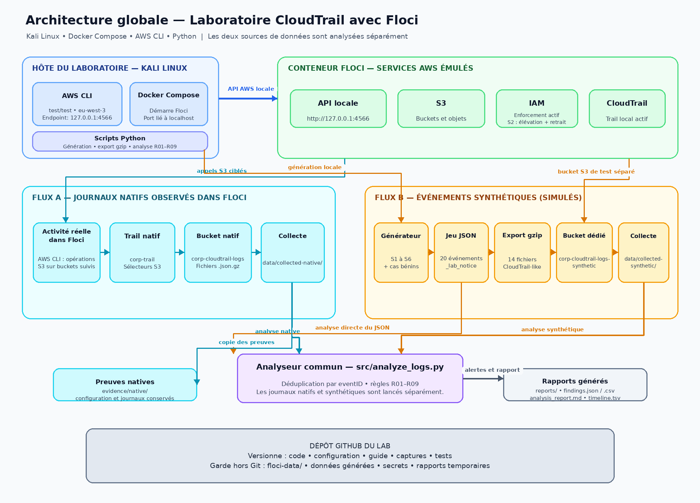

# Laboratoire d’investigation CloudTrail avec Floci

Projet pédagogique exécuté localement sous Kali Linux avec Docker Compose, Floci, AWS CLI et Python. Il permet de configurer un trail local, d’observer certains événements S3, de tester une élévation IAM dans l’émulateur et d’analyser séparément des scénarios CloudTrail synthétiques.

**Auteur : Ichrak Laadimi**

> **Aucun compte AWS réel n’est utilisé.** Les événements créés par le générateur Python sont synthétiques et portent `_lab_notice`. Les journaux natifs de Floci sont une source distincte et ne valident pas exhaustivement le comportement d’AWS.

## Objectifs

- Démarrer Floci avec l’application des autorisations IAM activée.
- Créer des buckets S3, des utilisateurs et une politique de laboratoire.
- Démontrer le gain de permissions de Bob, puis retirer la policy administrateur.
- Configurer un trail et collecter les événements S3 observés dans Floci.
- Générer six scénarios synthétiques, appliquer neuf règles de détection et produire des rapports.
- Garder les preuves natives séparées des données synthétiques.

## Architecture locale



## Outils et technologies


## Prérequis

- Kali Linux avec Docker Engine et Docker Compose v2.
- AWS CLI, Python 3, `jq` et `gzip`.
- Accès Internet pour télécharger l’image Floci.

## Démarrage

À la racine du dépôt :

```bash
cp .env.example .env
sudo docker compose up -d
sudo docker compose ps
```

Si `.env` existe déjà, conserve son contenu. Le port Floci est publié uniquement sur `127.0.0.1:4566`. Le conteneur est configuré avec `FLOCI_SERVICES_IAM_ENFORCEMENT_ENABLED=true` et CloudTrail activé.

Dans le terminal Kali, configure les identifiants **factices** du laboratoire :

```bash
export AWS_ENDPOINT_URL=http://127.0.0.1:4566
export AWS_ACCESS_KEY_ID=test
export AWS_SECRET_ACCESS_KEY=test
export AWS_DEFAULT_REGION=eu-west-3
aws --endpoint-url "$AWS_ENDPOINT_URL" sts get-caller-identity
```

L’identité attendue est le compte local Floci `000000000000`, et non un compte AWS.

Le guide détaillé, étape par étape, se trouve dans [`docs/guide-laboratoire.md`](docs/guide-laboratoire.md).

## Organisation du dépôt

| Chemin | Rôle |
|---|---|
| `docker-compose.yml` | Démarrage du service Floci sous Kali |
| `config/dev-policy.json` | Policy volontairement trop permissive attachée à Bob |
| `config/s3-selectors.json` | Sélecteurs du trail pour les objets S3 sensibles |
| `src/generate_events.py` | Génération du jeu synthétique S1–S6 et des événements bénins |
| `src/export_s3_layout.py` | Export en fichiers `.json.gz` avec une arborescence CloudTrail |
| `src/analyze_logs.py` | Analyse des journaux et règles R01–R09 |
| `scripts/00_check_env.sh` | Vérifications de base de l’environnement |
| `tests/` | Vérifications de cohérence du pipeline |
| `docs/images/architecture-globale-cloudtrail-floci.png` | Architecture globale du laboratoire |
| `docs/screenshots/` | Captures renommées et classées par étape |
| `evidence/native/` | Emplacement des preuves natives conservées |
| `reports/` | Résultats générés localement ; non versionnés par Git |
| `data/`, `floci-data/` | Données locales ignorées par Git |

## Jeu synthétique

Le générateur crée 20 événements répartis entre les scénarios S1 à S6 et des cas bénins :

- S1 : création puis utilisation d’une clé pour `svc-backup` ;
- S2 : attribution simulée d’`AdministratorAccess` à Bob ;
- S3 : suppression simulée d’un bucket critique ;
- S4 : modification de la journalisation et trou de 71 minutes ;
- S5 : échecs de connexion puis succès sans MFA ;
- S6 : appels refusés rapprochés.

Les événements générés ne sont pas émis par Floci. Leurs IP utilisent des plages réservées à la documentation.

```bash
python3 src/generate_events.py
python3 src/analyze_logs.py data/synthetic/dataset_synthetic.json
```

## Journaux natifs de Floci

Le trail `corp-trail` cible les objets des buckets `corp-backups-prod` et `corp-finance-secrets`, avec livraison dans `corp-cloudtrail-logs`. Après une opération S3 et le délai de livraison, collecte les fichiers :

```bash
mkdir -p data/collected-native
aws --endpoint-url "$AWS_ENDPOINT_URL" s3 sync \
  s3://corp-cloudtrail-logs/ data/collected-native/
python3 src/analyze_logs.py data/collected-native
```

Les preuves observées dans ce laboratoire incluent des opérations S3 telles que `PutObject`, `HeadObject`, `GetObject` et `DeleteObject`. Les journaux IAM natifs ne sont pas supposés complets : le test S2 est démontré par les réponses IAM et les preuves conservées, pas par une trace CloudTrail native confirmée.

## Export synthétique vers un bucket Floci distinct

Le bucket synthétique reste séparé du bucket natif :

```bash
python3 src/export_s3_layout.py
aws --endpoint-url "$AWS_ENDPOINT_URL" s3 mb s3://corp-cloudtrail-logs-synthetic
aws --endpoint-url "$AWS_ENDPOINT_URL" s3 sync \
  data/synthetic-layout/ s3://corp-cloudtrail-logs-synthetic/
mkdir -p data/collected-synthetic
aws --endpoint-url "$AWS_ENDPOINT_URL" s3 sync \
  s3://corp-cloudtrail-logs-synthetic/ data/collected-synthetic/
python3 src/analyze_logs.py data/collected-synthetic
```

Résultat observé pendant la réalisation : 14 fichiers gzip, 20 événements uniques et 12 alertes après récupération. Les sorties sont susceptibles d’évoluer si les scripts ou les données changent.

## Règles de détection

| Règle | Détection |
|---|---|
| R01 | Connexion console réussie sans MFA |
| R02 | Attribution de privilèges administrateur |
| R03 | Création ou usage suspect d’une clé d’accès |
| R04 | Suppression d’un bucket S3 |
| R05 | Altération de la journalisation CloudTrail |
| R06 | Rafale d’accès refusés |
| R07 | Échecs de connexion répétés suivis d’un succès |
| R08 | Trou de journalisation |
| R09 | Activité depuis une IP hors périmètre |

## Captures d’écran

Les captures de la réalisation sont classées dans [`docs/screenshots/`](docs/screenshots/README.md), du démarrage de Floci aux résultats d’analyse.

## Limites et précautions

- Floci émule des services AWS ; il ne constitue pas une validation exhaustive d’AWS.
- Les événements synthétiques ne doivent jamais être présentés comme des traces réelles.
- L’image `floci/floci:latest` peut changer ; fixer une version pour une reproduction stricte.
- Les clés créées pour le test sont des secrets de laboratoire : ne jamais les publier.
- Ne pas exposer le port Floci sur un réseau public.
- Préserver les journaux et preuves avant toute réinitialisation.

## Référence

La structure et certains objectifs s’inspirent du dépôt [othmane71-art/cloudtrail-lab](https://github.com/othmane71-art/cloudtrail-lab). Les différences entre l’archive LocalStack fournie et le déroulé personnel sur Floci sont décrites dans [`docs/source-reference.md`](docs/source-reference.md).
